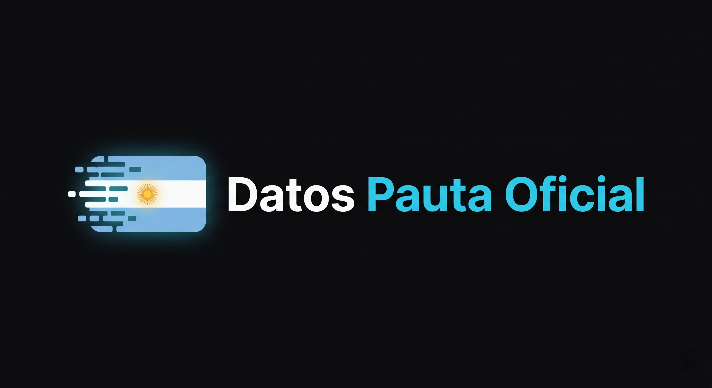

[Español](README.md) | [English](README.en.md)

<p align="center">
  
</p>

# Datos Pauta Oficial — La primera y única base unificada de pauta oficial argentina

🌐 **Deploy en producción:** [datospautaoficial.com.ar](https://datospautaoficial.com.ar)
🎬 **Video de presentación:** [Ver en YouTube](https://youtu.be/o8Ht_Qv4Ji4)

Web pública, neutral y open source que consolida los datos de publicidad oficial (pauta) de Argentina en un solo lugar: **554.021 órdenes de publicidad** de cuatro jurisdicciones (Nación, CABA, Provincia de Buenos Aires y Santa Fe), período 2003–2025, con montos deflactados por inflación para que las cifras sean comparables entre años.

La postura es estrictamente informativa: sin denuncia ni opinión.

---

## 🔍 El diferencial: datos que no existían en ningún otro lado

Hasta este proyecto, la información estaba dispersa en portales de datos abiertos, planillas y PDFs de cada jurisdicción, con formatos incompatibles entre sí y sin posibilidad de comparar montos entre años o gobiernos.

**PBA 2020–2024 es un dataset exclusivo de este proyecto.** La Provincia de Buenos Aires no publica sus órdenes de publicidad en datasets abiertos para ese período: la información estaba enterrada en resoluciones individuales en PDF. Mediante un script programado fui extrayendo los datos **resolución por resolución**, desde los anexos publicados en [normas.gba.gob.ar](https://normas.gba.gob.ar), para reconstruir el detalle de cada orden (proveedor, medio, monto, expediente). Son datos que no existen en ningún portal de datos abiertos. La cobertura es parcial: no todas las resoluciones publicadas están cargadas, sobre todo en 2020–2022.

---

## 📊 Cobertura de datos

| Jurisdicción | Período | Órdenes |
|---|---|---|
| Nación | 2009–2022 | 224.175 |
| CABA | 2003–2025 (2025 parcial) | 224.677 |
| Santa Fe | 2008–2023 | 61.187 |
| PBA | 2020–2025 (parcial) | 43.982 |
| **Total** | **2003–2025** | **554.021** |

Los huecos de cobertura se muestran de forma explícita en la web: nunca se presentan agregados que puedan engañar por cobertura incompleta.

Cada corrección de datos queda registrada, con su evidencia, en [CORRECCIONES.md](CORRECCIONES.md).

---

## 🏗️ Arquitectura

Los datos corren **100% sin backend ni servidores**: la base de datos SQLite completa (~176 MB) vive en Cloudflare R2 como un único archivo versionado, y el navegador consulta solo los bytes que necesita vía HTTP Range Requests gracias a `sql.js-httpvfs`. La única pieza de servidor es el formulario de contacto: un Cloudflare Worker (`workers/contacto`) que reenvía el mensaje por Email Routing sin exponer la dirección de destino.

```text
Fuentes oficiales (CSV / Excel / PDF por jurisdicción)
↓
Extractores Python (etl/extractores/extract_{caba,nacion,pba,santa_fe}.py)
↓
unificar.py → CSV canónico (8 columnas, 554.021 filas) → validar.py
↓
build_db.py → SQLite deflactada (IPC INDEC) + caches precomputados
(totals_cache, rankings_cache, groups_cache, home.json)
↓
Archivo versionado en Cloudflare R2 (db.datospautaoficial.com.ar)
↓
Astro + React islands → consultas SQL desde el navegador (sql.js-httpvfs)
↓
Cloudflare Pages (datospautaoficial.com.ar)
```

---

## 🛠️ Stack Tecnológico

| Capa | Tecnología |
|------|------------|
| **ETL** | Python (extractores modulares por jurisdicción, unificación, validación) |
| **Base de datos** | SQLite estática, consultada desde el browser con `sql.js-httpvfs` |
| **Framework** | Astro 6 (static output) + React 19 (islands) |
| **Lenguaje** | TypeScript |
| **Búsqueda** | MiniSearch (índice client-side de proveedores y medios) |
| **Hosting** | Cloudflare Pages + Cloudflare R2 (base de datos) |
| **Deflactación** | IPC INDEC (+ serie Eco Go 2007–2015), montos a pesos constantes |

---

## 🎯 Funcionalidades

**Tabla explorable de 554 mil órdenes**
- Filtros cruzados por jurisdicción y año, agrupación por proveedor/medio con filas expandibles y paginación de 25 registros por página
- Primer paint instantáneo: el estado inicial viene precomputado e inlineado por Astro (`home.json`) — sql.js se inicializa recién cuando el usuario interactúa
- El dato mostrado es el **crudo exacto de la fuente oficial**, sin normalización

**"Cuánto recibió" — buscador de entidades**
- Toggle ternario Proveedor / Medio / **Grupo mediático**: el modo grupo consolida las razones sociales de cada holding según el [Media Ownership Monitor Argentina](https://argentina.mom-gmr.org/), con panel de transparencia y disclaimer
- Imagen PNG 1080×1080 descargable para compartir en redes, generada con Canvas API puro, sin dependencias
- Deeplinks compartibles que restauran entidad, modo y año

**Rankings**
- Top de proveedores, medios y grupos mediáticos por jurisdicción y año, servidos desde caches precomputados en el build (sin scans sobre la tabla principal)

**Compartir web**
- Botón en el navbar (desktop e integrado en el menú hamburguesa en mobile) con dos opciones: compartir directamente en X o copiar el link al portapapeles

**Contacto**
- Formulario en `/contacto`: el mensaje llega por mail sin que la dirección aparezca en el sitio

**Página de metodología**
- Fuentes, criterios de deflactación y de normalización documentados públicamente

---

## 🧮 Decisiones de datos

- **Montos deflactados, no nominales.** Todos los montos están expresados en pesos constantes (IPC INDEC). Comparar pauta de 2009 con la de 2024 en pesos nominales no tiene sentido en Argentina.
- **Sin normalización en la tabla, normalización transparente en agregados.** La tabla muestra el dato exacto de la fuente. Los rankings y "Cuánto recibió" aplican solo unificación de variantes de escritura de la misma razón social (`aliases.csv`, curado conservador). La consolidación por propiedad (grupos mediáticos) es un toggle opcional, separado y con fuente citada.
- **Honestidad sobre los huecos.** Cada limitación de la fuente (filas sin fecha, períodos parciales) se documenta en vez de ocultarse.

---

## 📝 Notas de Desarrollo

Desarrollo apoyado fuertemente en IA a lo largo de todo el ciclo: como motor para acelerar la producción y como segunda opinión ante decisiones técnicas. Las decisiones de producto, arquitectura y tratamiento de datos son propias.

---

## 👤 Autor

**Iván Gómez Dell'Osa**

- Web: [ivangomezdellosa.com.ar](https://www.ivangomezdellosa.com.ar)
- Email: [ivangomezdellosa@gmail.com](mailto:ivangomezdellosa@gmail.com)
- LinkedIn: [linkedin.com/in/ivangomezdellosa](https://www.linkedin.com/in/ivangomezdellosa/)
- GitHub: [IvanGomezDellOsa](https://github.com/IvanGomezDellOsa)
